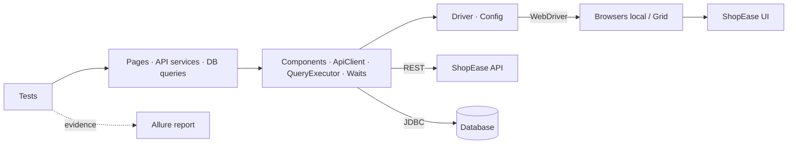
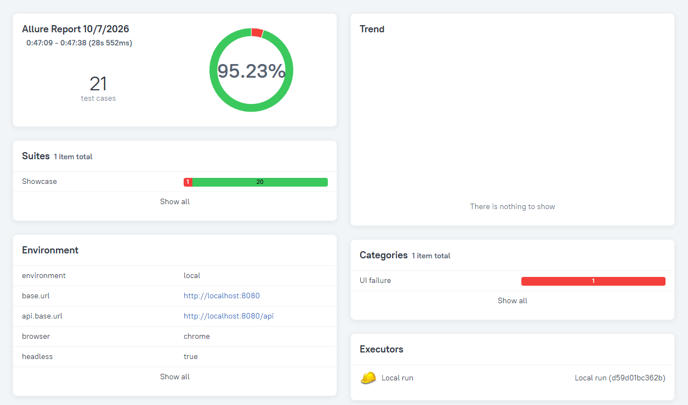
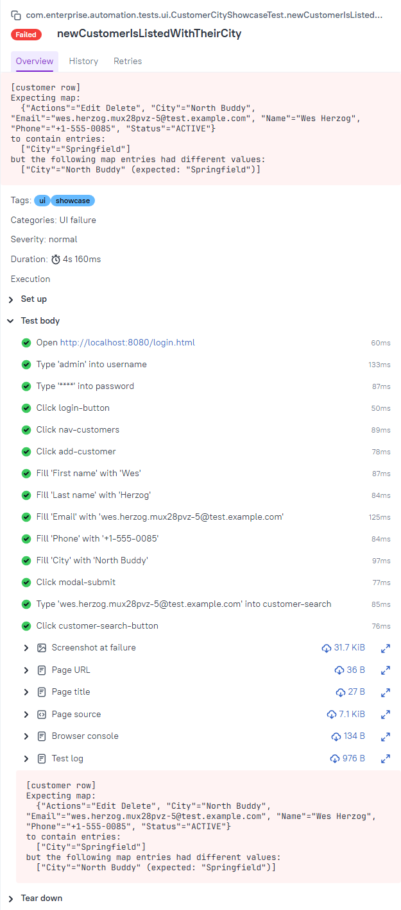
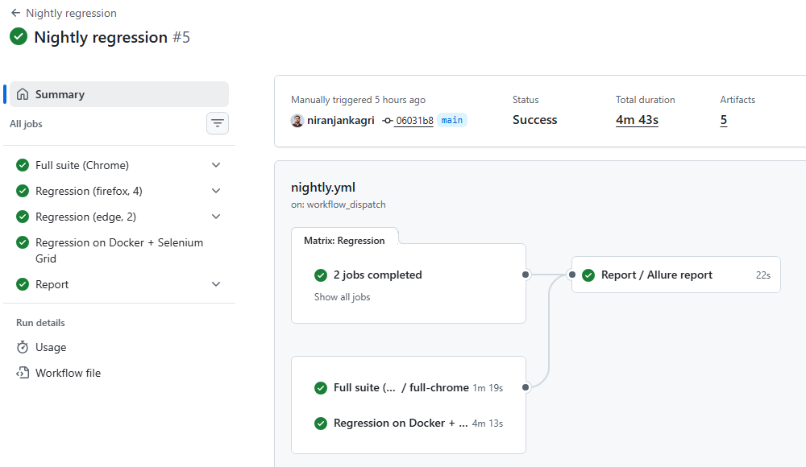

# Enterprise Test Automation Framework

[](https://github.com/niranjankagri/enterprise-test-automation-framework/actions/workflows/regression.yml)
[](https://github.com/niranjankagri/enterprise-test-automation-framework/actions/workflows/nightly.yml)
     

## Overview

**Production-style enterprise test automation platform demonstrating UI, API, database, integration, parallel execution, observability, containerization and CI/CD automation.**

UI, API and database testing of one application, with parallel execution, a resilience policy, an evidence-rich Allure report, Docker + Selenium Grid and GitHub Actions pipelines.

This is a portfolio project, not a framework running in a company: it shows how such a platform is designed, built, documented and operated, against an application built for it (below). Its limits are listed under [Known limitations](#known-limitations).

It tests **ShopEase Admin** ([`demo-app`](demo-app/README.md)), a small shop back office kept in this repository, so the same business record can be checked through the UI, the REST API and the database.

New here? Read the **[complete framework guide](docs/FRAMEWORK-GUIDE.md)**.

Companion repository: [selenium-java-framework](https://github.com/niranjankagri/selenium-java-framework), an interview-focused Selenium lab. This repository is the engineering side: architecture, scale and delivery.

**Why the app is in this repository:** the tests run against their own copy, started fresh for every run, locally and in
CI. No shared or hosted environment means no outages, no test data shared between runs, and no change somewhere else
that breaks these tests; one clone and one command run everything. It is also built for this framework: the same record
can be checked through the UI, the API and the database.

## Objectives

- Validate behaviour at the cheapest level (API), and consistency across UI, API and database.
- Independent, data-owning, parallel-safe tests: no order dependencies, no shared fixtures, no sleeps.
- Every failure explains itself: steps, request/response, rows, screenshot, log, environment, build.
- Same tests everywhere: laptop, Docker, Selenium Grid, CI, configured, never edited.

## Architecture



Layers depend downwards only; tests contain no Selenium, HTTP or SQL. Full description and diagrams: [docs/architecture.md](docs/architecture.md); 21 architecture decision records: [docs/adr](docs/adr/README.md).

## Technology stack

| Area | Tools |
|---|---|
| Language / build | Java 17, Maven (multi-module) |
| Test runner | TestNG 7.12.0 (groups, suites, listeners, data providers) |
| UI | Selenium 4.51.0 (local, Selenium Grid) |
| API | REST Assured 6.2.0, Jackson, JSON Schema validation |
| Database | JDBC (H2), parameterized queries |
| Assertions | AssertJ |
| Test data | Datafaker, JSON and CSV files |
| Logging | SLF4J + Logback (per-thread, per-test context) |
| Reporting | Allure 3.0.0 (allure-testng) |
| Containers | Docker, docker compose, Selenium Grid (hub + Chrome/Firefox/Edge nodes) |
| CI/CD | GitHub Actions, Dependabot, dependency review, Checkstyle |

## Project structure

```text
enterprise-test-automation-framework/
├── pom.xml                         parent POM: all versions, compiler settings
├── demo-app/                       application under test: UI + REST API + H2 (JDK HTTP server)
├── automation/
│   ├── src/main/java/.../automation
│   │   ├── config                  layered immutable configuration
│   │   ├── driver                  browser options, factory, one browser per thread
│   │   ├── ui (+ components, pages) waits, actions, component and page objects
│   │   ├── api (+ models, services) client, records, one service per resource
│   │   ├── db                      connection, queries, assertions
│   │   ├── data                    records, generators, factory, readers, clean-up
│   │   ├── listeners               settings, retry, diagnostics, metadata, evidence
│   │   ├── reporting               report steps, log capture, Allure run files
│   │   └── utils                   waits, screenshots, failure classification
│   └── src/test
│       ├── java/.../tests          api, ui, db, integration, e2e, platform, base
│       └── resources               suites/*.xml, testdata/*, schemas/*, allure.properties
├── config/checkstyle.xml           code-quality gate
├── docker/                         Dockerfile, docker-compose.yml
├── docs/                           architecture, design, strategy, CI/CD, ...
└── .github/                        workflows, Dependabot
```

## UI automation

Page Objects composed of Component Objects (`TableComponent`, `ModalComponent`, `ToastComponent`, `HeaderComponent`, `NavigationComponent`); `data-testid` locators defined once; explicit waits only, on the application's real state (`body[data-ready]`, loader); one fresh browser per test.

```java
CheckoutPage checkout = loginAsAdmin().navigation().openProducts()
        .addToCart("Wireless Mouse")
        .header().openCart();
assertThat(checkout.total()).isEqualTo("$49.00");
```

Accessibility: `AccessibilityAssertions` runs axe-core (WCAG 2.0/2.1/2.2 A and AA rules plus best practices) inside the existing Selenium tests on the login page, dashboard navigation, the customer list and add-customer dialog, and checkout; the checkout test also checks that keyboard focus is visible.

## API automation

`Test → ApiSession → Service → ApiClient → REST API`. Raw responses for status/header/error checks, typed records for happy paths, strict JSON schemas, bearer tokens per account.

```java
CustomerResponse created = ApiSession.admin().customers().createCustomer(TestDataFactory.newCustomer());
ErrorResponse error = ApiAssertions.error(expectStatus(ApiSession.viewer().customers().create(body), 403));
```

Mapped API tests exercise examples across GET/POST/PUT/PATCH/DELETE, response statuses, headers, payloads, authentication, authorization, validation and business rules (stock, order status flow). See the [coverage matrix](docs/TEST_COVERAGE_MATRIX.md) for route-level evidence and known gaps.

### Transport, session and request bounds

API connection/read timeouts default to 5000/30000 ms. Override with
`-Dapi.connect.timeout.millis` / `-Dapi.read.timeout.millis`, or the equivalent
`API_CONNECT_TIMEOUT_MILLIS` / `API_READ_TIMEOUT_MILLIS` environment variables.
They are independent of browser waits. `ApiClient.forEndpoint` supports isolated
service fixtures with positive explicit transport timeouts.

`ApiSession` reuses tokens only until expiry and scopes them to endpoint and
credentials. After logout, role changes or external app restart, call
`ApiSession.forgetToken(username)` or `clearTokens()`. The local app lifecycle clears
cached tokens. Automatic replay of writes after authentication failure is deliberately
not performed. Role changes revoke existing server sessions; sign in again.

Customer PATCH preserves absent fields and clears phone/city for explicit JSON null.
Request bodies are bounded at 1 MiB; orders at 1000 lines. SQL bound parameters are
redacted from evidence; use parameterized SQL, never untrusted concatenated fragments.

## Database validation

```java
assertRow(db.customerByEmail(email), "customer " + email).hasValue("city", "Pune").hasValue("status", "ACTIVE");
```

API → DB (stored exactly as sent, transactions, password hashing) and UI → API → DB consistency. Environments without database access skip these tests with a reason.

## Test data management

`TestDataFactory.newCustomer()` (unique and valid, Datafaker + run-unique suffix), variants with `withEmail(...)`, reference data from `testdata/products.json`, negative cases from CSV shared by UI and API tests. Every test registers the removal of what it creates (`CleanupRegistry`); setup and clean-up of UI tests go through the API.

## Configuration

System property → environment variable → `config/<env>.properties` → `config/default.properties`.

| Setting | Values (default) |
|---|---|
| `env` / `ENV` | `local` (starts the app), `qa`, `staging` |
| `browser` | `chrome`, `firefox`, `edge` |
| `headless` | `true` / `false` (default `false`; local) |
| `app.autostart` | `true` / `false` (`true` for local; otherwise `false`) |
| `execution` | `local`, `remote` (Selenium Grid at `grid.url`) |
| `parallel`, `threads` | `classes`, `2` |
| `retry.count` | `1` (infrastructure failures only) |
| `base.url`, `api.base.url`, `db.url` | per environment |
| `ADMIN_PASSWORD`, `VIEWER_PASSWORD`, `DB_*` | secrets: environment variables only (see `.env.example`) |

Boolean values are trimmed and case-insensitive, but must be exactly `true` or `false`. Environment files inherit settings omitted from that file from `config/default.properties`. Invalid booleans stop startup with a message naming the key without echoing the supplied value; other invalid settings fail with key-specific diagnostics and supported values where applicable.

## Parallel execution

`./mvnw test -Dthreads=4`. One browser per thread, unique data, per-thread clean-up and logs. Historical timing observations are documented in [docs/parallel-execution.md](docs/parallel-execution.md); runtimes vary by machine and suite contents, and are not a coverage measure.

## Retry strategy

Only transient infrastructure failures are retried: browser start-up, lost sessions, refused connections; both for test methods and for browser start-up in `@BeforeMethod`. Assertion failures and wait timeouts are never retried. Retries are logged and visible in the report.

## Logging

Console (INFO) and `automation/target/logs/automation.log` (DEBUG) with `[thread] [Test.method] [component]` (UI, API, DB...) on every line, START/PASS/FAIL per test, a diagnostics block per failure, one line per API call. Secrets are masked.

## Reporting

Allure: every UI action, API call (request/response attached) and SQL query is a step; failed UI tests get screenshot, URL, title, page source and browser console; database steps name the query and show its duration; each test has its own log; Environment panel with environment, browser, Git commit and build; API steps show duration and the correlation id (`X-Request-Id`, also in the application log); failures categorised as configuration, infrastructure, timeout, authentication/authorization, database, UI, API, assertion or test/framework error. [docs/reporting.md](docs/reporting.md).

Report of a smoke run with one deliberately failing check (a demo test, not part of the suites): overview with environment, executor and failure category, and the failed test with every step (password typed as `****`), the assertion and the evidence attachments.

<p>
  
  
</p>

## Docker

```bash
docker compose -f docker/docker-compose.yml up --build --abort-on-container-exit --exit-code-from tests
```

Application, Selenium hub, Chrome/Firefox/Edge nodes and the test runner; `SUITE`, `BROWSER`, `THREADS` variables. [docs/docker.md](docs/docker.md).

## Selenium Grid

`./mvnw test -Dexecution=remote -Dgrid.url=http://localhost:4444 -Dbrowser=firefox`: the same browser options as local runs. Set `GRID_URL` to the address your test process can reach. [docs/grid.md](docs/grid.md).

## Cloud execution

Not implemented by decision: `-Dexecution=cloud` fails fast with a clear message. Remote browsers are covered by Selenium Grid; a cloud provider (BrowserStack, LambdaTest) would be added as another `RemoteWebDriver` target in `DriverFactory` with credentials from CI secrets.

## CI/CD

| Pipeline | Trigger | Runs |
|---|---|---|
| CI | pull request | compile (warnings = errors), Checkstyle, Allure failure verifier, unit tests → API regressions, database/order integration and Chrome smoke → merged JaCoCo coverage report; dependency review; report |
| Main | push to main | build → API → UI → smoke on Edge → report |
| Nightly | daily + manual (+ PRs labelled `full-validation`) | full suite (Chrome), regression (Firefox, Edge), regression on Docker + Grid with JaCoCo coverage of the containerised app → report |
| CodeQL | push, pull request, weekly | static security analysis of the Java code |



[docs/ci-cd.md](docs/ci-cd.md).

CI/container browser execution sets `SE_AVOID_STATS=true` to disable Selenium Manager
telemetry. For a local browser run, set the same environment variable before Maven.
Add the `full-validation` PR label to execute the existing full browser/Grid Nightly
workflow on that PR revision. Scheduled and manual Nightly runs remain unchanged.

## Quality gates

Compilation without warnings (CI), Checkstyle (no sleeps, no implicit waits, no empty catch, no unused imports...), all tests green, no new high-severity vulnerable dependency (dependency review on every PR), Dependabot security alerts and grouped weekly updates, CodeQL analysis. JaCoCo coverage is merged from the unit, API, integration and smoke jobs; the merge step fails if any input is missing or comes from another commit, and the report check fails if production classes were not executed. `main` is protected by a ruleset: changes reach it only through a pull request whose required quality-gate check passed.

## Security

No real credentials in code or Git (scan of all files and the full history); the only passwords in the repository are the public default demo-account passwords of the self-hosted demo app (`local`/`qa`, documented, overridable), while `staging` requires them from the environment; secrets from environment/CI only, `.env` ignored and `.env.example` provided, one masking utility (`SecretMasker`) for passwords, tokens, client secrets, API keys, cookies and URL credentials in every log line, report attachment, failure message, test parameter, the run metadata and `toString()`; the application stores salted password hashes, which a test verifies.

## Running tests

Requirements: JDK 17+, Chrome/Edge (Selenium Manager can download Firefox), and Node.js for the Allure CLI. The checked-in Maven Wrapper pins Maven 3.9.16: use `./mvnw` in macOS/Linux/Git Bash, `mvnw.cmd` in Windows Command Prompt, or `.\mvnw.cmd` in PowerShell; a separate Maven installation is not required.

```bash
./mvnw clean test                                   # full suite, local app, Chrome
./mvnw clean test -Dsuite=smoke -Dheadless=true     # a suite
./mvnw clean test -Dbrowser=firefox -Dthreads=4     # another browser, more threads
./mvnw clean test -Denv=qa                          # app started separately on 8081
npx allure-commandline serve automation/target/allure-results
```

In PowerShell, use `.\mvnw.cmd` and quote each Maven `-D` argument, for example `.\mvnw.cmd clean test '-Dsuite=smoke' '-Dheadless=true'`. In Windows Command Prompt, use `mvnw.cmd`.

## Test suites

| Suite | What it selects |
|---|---|
| `full` (default) | All test groups except the deliberately failing Allure redaction fixture, which runs only through its verifier. |
| `unit` | Framework and configuration tests; the suite does not start the application or use a browser. |
| `smoke` | Fast usability and critical-path checks tagged `smoke`. |
| `sanity` | Targeted happy-path and role checks tagged `sanity`. |
| `regression` | Broader API, UI, database and journey tests tagged `regression`; this group is not a claim of complete functional coverage. |
| `api` | API tests tagged `api`. |
| `ui` | Browser tests tagged `ui`. |
| `integration` | Tests tagged `integration` and `db`, including API/database and cross-layer checks. |
| `e2e` | Business journeys tagged `e2e`. |

Suite XML files select TestNG groups, which can overlap. Test totals change as tests and data providers change; they are execution evidence, not a coverage measure. The current requirement and test mapping is in [docs/TEST_COVERAGE_MATRIX.md](docs/TEST_COVERAGE_MATRIX.md).

## Reports

`automation/target/allure-results` (Allure), `automation/target/screenshots`, `automation/target/logs/automation.log`, `automation/target/execution-metadata.json`, `automation/target/surefire-reports`. CI uploads all of them plus the generated report.

## Test strategy

Test pyramid with the bulk at API level, UI for what only the UI shows, cross-layer checks for consistency; equivalence classes, state transitions, role checks, negative and data-driven tests. [docs/test-strategy.md](docs/test-strategy.md).

## Architecture decisions

21 ADRs (Problem → Options → Decision → Reason → Trade-offs), one file each in [docs/adr](docs/adr/README.md), e.g. Selenium + TestNG, REST Assured, Allure, Docker + Grid, GitHub Actions, cloud deferred, self-hosted application under test, layered configuration, components over inheritance, waiting for real state, tests owning their data, retrying infrastructure only, report evidence collected by the framework.

## Known limitations

- Cloud device farms are not integrated (see Cloud execution).
- The application under test uses an in-memory H2 database and demo-grade security (salted SHA-256, in-memory tokens); it exists to be tested, not to be deployed.
- Allure steps are user-action level; there are no business-level step names on page methods yet.
- API-only tests can only deactivate the products they create (the API keeps products for order history), so repeated runs against a long-lived environment accumulate inactive `TST-` products; assertions ignore them, and tests with database access hard-delete theirs ([ADR-009](docs/adr/ADR-009-every-test-owns-its-data.md)).
- Surefire is held on 3.5.x: 3.6 removed TestNG suite-file support, which the suites rely on.

## Future enhancements

- BrowserStack/LambdaTest execution target.
- Publishing the Allure report with history to GitHub Pages.
- Contract tests (OpenAPI) and performance smoke tests (k6/Gatling) in the nightly run.
- Visual comparison checks on key pages (axe accessibility checks are already in place, see UI automation).
- PostgreSQL for the application in Docker, to validate against a production-like database.

## Documentation

**Start here: [the complete framework guide](docs/FRAMEWORK-GUIDE.md)**, which covers everything in one document (application under test, architecture, configuration, every layer, test data, coverage, execution, logging, reporting, Docker, CI/CD, security, extending, troubleshooting, class reference).

Topic documents: [Architecture](docs/architecture.md) · [Framework design](docs/framework-design.md) · [Test strategy](docs/test-strategy.md) · [CI/CD](docs/ci-cd.md) · [Docker](docs/docker.md) · [Selenium Grid](docs/grid.md) · [Decisions (ADRs)](docs/adr/README.md) · [Parallel execution](docs/parallel-execution.md) · [Reporting](docs/reporting.md) · [Troubleshooting](docs/troubleshooting.md) · [Coding standards](docs/coding-standards.md) · [Demo and interview guide](docs/demo.md) · [Contributing](CONTRIBUTING.md)

## License

[MIT](LICENSE)
